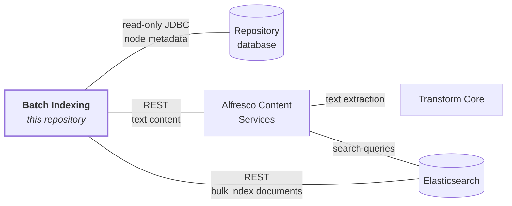

# Alfresco Community Search

[](https://github.com/Alfresco/alfresco-community-search/actions/workflows/ci.yml)
[](LICENSE.txt)

Search indexing for [Alfresco Content Services](https://github.com/Alfresco/alfresco-community-repo)
Community Edition, built on Elasticsearch. It replaces Alfresco Search Services, which was built on
[Apache Solr](https://solr.apache.org/).

> **Note**
> This repository is being assembled. Some modules are present as build definitions while their
> sources are migrated. Sections marked _Coming soon_ below are not yet available.

## Table of Contents

1. [Overview](#overview)
2. [How it fits together](#how-it-fits-together)
3. [Modules](#modules)
4. [Artifacts](#artifacts)
5. [Building from source](#building-from-source)
6. [Running from source](#running-from-source)
7. [Documentation](#documentation)
8. [Branches](#branches)
9. [Contributing](#contributing)
10. [License](#license)
11. [Helpful links](#helpful-links)

## Overview

Alfresco stores content — files, folders, metadata, permissions — in a repository backed by a
relational database. To make that content searchable, it has to be extracted, transformed into
index documents, and written to a search engine. This project does that job for Community Edition.

The main deliverable is **batch indexing**: a standalone Spring Boot application that keeps an
Elasticsearch index in sync with an Alfresco repository. It reads nodes directly from the
repository database, converts them into index documents, and bulk-upserts them into Elasticsearch.
It runs on a fixed-delay loop over a sliding time window, so newly created and modified content
becomes searchable without any message broker in the deployment.

Reading from the database rather than from an event stream is the defining design choice. It means
the indexer needs no ActiveMQ, no Camel routes, and no coordination with the repository beyond
read-only database access — which is what makes it deployable in a Community-sized stack.

## How it fits together

Each line is a connection, labelled with how it is made and what travels over it.



Content extraction goes **through ACS**, not directly to Transform Core: the indexer calls the ACS
REST endpoint `/service/api/solr/textContent` using shared-secret authentication, and ACS handles
the rendition internally. Transform Core aggregates the individual rendition engines, so ACS talks
to it rather than to each engine.

Metadata comes from the database and text content comes from ACS — the two paths are independent.
Setting `alfresco.reindex.contentIndexingEnabled=false` drops the content path entirely, leaving an
indexer that needs only the database and Elasticsearch. Most deployments will want full-text search
and so will run a rendition engine.

**Relationship to ACS Community.** This project is a separate deployable, not part of the
repository. ACS queries Elasticsearch for search results; this project is what puts the documents
there. The two share only the repository database (read-only here) and the index schema.

**Relationship to Search Enterprise.** Alfresco Search Enterprise builds on the libraries published
from this repository rather than forking them. The `alfresco-search-opensearch-client` module is
the shared foundation: enterprise adds live indexing over ActiveMQ/Camel, AWS IAM authentication,
and path indexing on top of it. Fixes to the shared client benefit both editions.

## Modules

| Module | Description |
| --- | --- |
| `alfresco-search-index-model` | Index field names, document-type constants, and schema definitions. Small and dependency-free, so anything that needs to agree on the index shape can depend on it without pulling in a search client. |
| `alfresco-search-opensearch-client` | The search-engine client. Connection and authentication configuration, index request and document model, field extractors, bulk upsert adapters, mTLS support, and the accepted-media-type cache. |
| `alfresco-search-opensearch-client-test` | Test fixtures for the client: Testcontainers initializers for Elasticsearch and Transform Core, index bootstrap helpers, a query DSL model, and an event generator. Test scope only. |
| `alfresco-search-reindexing-core` | Reusable Spring Batch building blocks — readers, processors, writers, and retry configuration — shared by the indexing jobs. |
| `alfresco-elasticsearch-batch-indexing` | The runnable Spring Boot application. Scheduling, job wiring, content transform, and watermark state. |
| `alfresco-elasticsearch-batch-indexing-distribution` | Packages the application as a Docker image. |

### Why the layering exists

The split between `index-model`, `opensearch-client`, and the application is deliberate, and it is
worth understanding before adding code to any of them.

**`index-model` is separate from the client** because the index schema is a contract shared by more
parties than just the indexer. Anything that reads or writes the index needs the same field names,
but most of those callers have no business depending on a search client and its transitive
dependencies. Keeping the constants in a tiny module lets them agree on the schema cheaply.

**`opensearch-client` is separate from the application** because it is the seam between Community
and Enterprise. Both editions index into the same Elasticsearch schema using the same request
builders, extractors, and connection handling; they differ in how work reaches the indexer
(scheduled database polling here, event-driven messaging in Enterprise) and in which
authentication modes they support. Putting the shared half in its own module lets Enterprise depend
on it as a published artifact instead of maintaining a divergent copy.

A practical consequence: code in `opensearch-client` must not depend on anything Enterprise-only.
Where Enterprise needs to extend behaviour, the client exposes an extension point and Enterprise
supplies the implementation.

## Artifacts

Releases publish to the
[Alfresco public Maven repository](https://artifacts.alfresco.com/nexus/#browse/browse:public)
under the `org.alfresco` group, with sources, and resolve anonymously — no credentials are needed
to build against them.

The batch indexing application is also published as a Docker image,
`alfresco/alfresco-elasticsearch-batch-indexing`. See the
[installation documentation][docs-install] for how to deploy it.

## Building from source

Prerequisites:

- JDK 17
- Maven 3.9 or later
- Docker, to run the tests that use containers

Everything the build needs resolves from public repositories, so no credentials are required:

```bash
mvn clean install
```

To build without running tests:

```bash
mvn clean install -DskipTests
```

See [CONTRIBUTING.md](CONTRIBUTING.md) for code formatting, commit hooks, and how to submit a pull
request.

## Running from source

Deploying Alfresco Search Community — including the Docker Compose stack, JAR deployment, and
cluster setup — is covered by the [installation documentation][docs-install]. This section is only
about running what you have just built, against an environment you already have.

You need a repository database with the Alfresco schema, an Elasticsearch instance, and — for
full-text search — Transform Core.

```bash
mvn clean install -DskipTests -pl alfresco-elasticsearch-batch-indexing -am
(cd alfresco-elasticsearch-batch-indexing/target && java -jar alfresco-elasticsearch-batch-indexing-*-app.jar \
  --spring.datasource.url=jdbc:postgresql://localhost:5432/alfresco \
  --spring.datasource.username=alfresco \
  --spring.datasource.password=alfresco \
  --spring.elasticsearch.uris=http://localhost:9200 \
  --elasticsearch.indexName=alfresco)
```

Configuration uses standard Spring Boot property sources, so any property can be supplied as a
command-line flag, in `application.properties`, or as an environment variable
(`alfresco.reindex.batchSize` becomes `ALFRESCO_REINDEX_BATCHSIZE`). The four settings above are
the minimum needed to start; everything else is documented in the
[configuration reference][docs-config-batch].

The PostgreSQL JDBC driver is bundled. For Oracle or SQL Server, put the driver jar in a
`db-drivers/` directory next to the jar — the fat jar's `Loader-Path: db-drivers/` manifest entry
picks it up. See [providing a JDBC driver][docs-config] for the container equivalent.

## Documentation

Product documentation — installation, configuration, administration, tuning, and query syntax —
lives on the Hyland documentation site and is versioned with each release. This README covers only
what is specific to working on the source.

| Topic | Where |
| --- | --- |
| Architecture and how indexing works | [Introduction][docs-intro] |
| Installing, including Docker Compose | [Install][docs-install] |
| Upgrading from an earlier version or from Solr | [Upgrade][docs-upgrade] |
| Full configuration property reference | [Configuring the Batch-Indexing Application][docs-config-batch] |
| Index management, performance tuning, monitoring, security | [Administer][docs-admin] |
| Query language and search syntax | [Using][docs-using] |
| Supported platforms and versions | [Supported Platforms][docs-platforms] |

Repository-specific documentation:

- **Design and architecture document** — the internals behind the product docs: scheduling model,
  processing pipeline, state storage, and failure handling. Useful if you are changing this code
  rather than operating it. _Coming soon._

<!-- TODO(placeholder): link to docs/batch-indexing/consolidated-design-document.md once ported. -->

- [Contributing guide](CONTRIBUTING.md)

[docs-intro]: https://docs.hyland.com/r/Alfresco/Alfresco-Search-Community/5.7/Alfresco-Search-Community/Introduction
[docs-install]: https://docs.hyland.com/r/Alfresco/Alfresco-Search-Community/5.7/Alfresco-Search-Community/Install
[docs-upgrade]: https://docs.hyland.com/r/Alfresco/Alfresco-Search-Community/5.7/Alfresco-Search-Community/Upgrade
[docs-config]: https://docs.hyland.com/r/Alfresco/Alfresco-Search-Community/5.7/Alfresco-Search-Community/Configure
[docs-config-batch]: https://docs.hyland.com/r/Alfresco/Alfresco-Search-Community/5.7/Alfresco-Search-Community/Configure/Configuring-Batch-Indexing-Application
[docs-admin]: https://docs.hyland.com/r/Alfresco/Alfresco-Search-Community/5.7/Alfresco-Search-Community/Administer
[docs-using]: https://docs.hyland.com/r/Alfresco/Alfresco-Search-Community/5.7/Alfresco-Search-Community/Using
[docs-platforms]: https://docs.hyland.com/r/Alfresco/Alfresco-Search-Community/5.7/Alfresco-Search-Community/Supported-Platforms

## Branches

The latest unreleased code is on the `master` branch. Releases are tagged, and long-lived release
lines live on `release/*` branches.

## Contributing

Contributions are welcome. Please read the [contributing guide](CONTRIBUTING.md) first — it covers
the build prerequisites, the formatting and commit hooks, and what a good pull request looks like.

Contributions are accepted under the project's [LGPL-3.0 licence](LICENSE.txt).

## License

Licensed under the GNU Lesser General Public License, version 3.0. See [LICENSE.txt](LICENSE.txt).

## Helpful links

- [Alfresco Content Services documentation](https://docs.hyland.com/p/alfresco)
- [Alfresco Community Repository](https://github.com/Alfresco/alfresco-community-repo)
- [Alfresco Platform](https://www.hyland.com/en/products/alfresco-platform)
- [Alfresco Community forum](https://hub.alfresco.com/)
